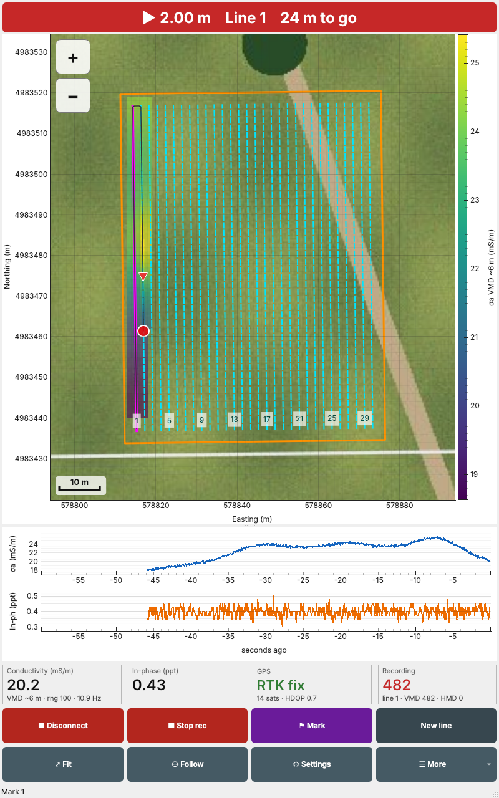
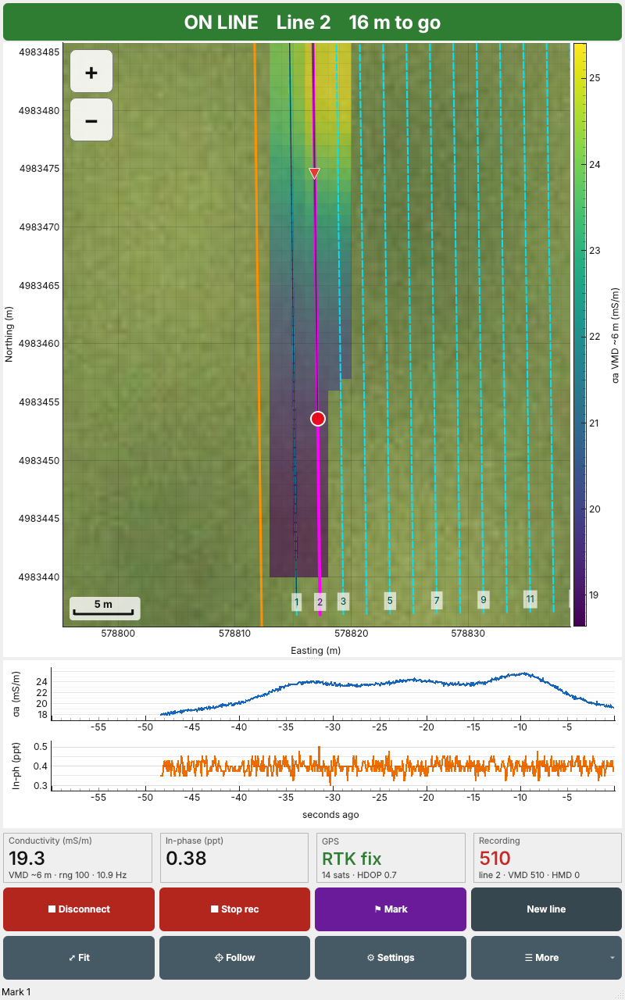

# EM31 Mapper User Manual

Version 0.5.0 · November 2026

## 1. Introduction

EM31 Mapper turns a Geonics EM31-MK2 and a GPS into a real-time conductivity mapping system on a Windows tablet. It reads both instruments over COM ports, positions every EM31 reading from the GPS track, logs everything to disk, and draws a live gridded map as you walk. Planned survey lines, a boundary and aerial imagery can be shown underneath, with steering guidance along each line.

This manual covers version 0.5.0.

### What you need

| Item | Requirement |
| --- | --- |
| Field computer | Juniper Mesa2 or any Windows 10/11 64-bit PC; touchscreen optional |
| EM31 | Geonics EM31-MK2 (standard 3.66 m boom or EM31-SH short boom), RS-232 output at 9600 baud |
| GPS | Any receiver streaming NMEA GGA sentences (GSA optional, for PDOP): Mesa2 internal GNSS, or external over Bluetooth, USB or serial |
| Cables | EM31 RS-232 to USB-serial adapter, or a Bluetooth serial link |
| Software | Nothing else to install. Python, Qt and the Microsoft C++ runtime are bundled in the program folder |

### What it does

- Live conductivity (mS/m) and in-phase (ppt) readouts, with 60-second profile strips.
- Time-interpolated positioning with GPS latency, layback and cross-track offset correction.
- Live inverse-distance-weighted grid of the survey, updated every few seconds.
- VMD and HMD dipole modes mapped separately, plus a VMD − HMD difference map.
- Planned lines and boundaries from GeoPackage, GeoJSON, CSV, GPX or KML, with on-line guidance.
- Offline aerial imagery: downloaded tiles or your own GeoTIFF.
- Logs a positioned CSV plus raw EM31 bytes and raw NMEA, flushed to disk every 2 s.
- Exports georeferenced grids (ESRI ASCII + .prj) and map images.
- Built-in simulator and self-test, for practice and checks without instruments.

## 2. Installing, updating and launching

The program is a self-contained folder, `C:\EM31Mapper`, delivered as a zip file. Nothing is installed into Windows.

### Install

1. Download [`EM31Mapper.zip`](https://github.com/yetiskier/em31-mapper/releases/latest/download/EM31Mapper.zip) (always the latest version) and copy it to the Mesa2 (a USB stick is easiest), or download it on the Mesa2 directly.
2. Right-click (on the touchscreen: press and hold) `EM31Mapper.zip` → **Extract All…**. Replace the suggested folder with `C:\` and click **Extract**.
3. Check that `C:\EM31Mapper\EM31Mapper.exe` exists. If you see `C:\EM31Mapper\EM31Mapper\…`, move the inner folder up to `C:\`.
4. Double-click `EM31Mapper.exe`. If Windows SmartScreen says “Windows protected your PC”, tap **More info → Run anyway** (the program is not code-signed).

### Shortcuts

- **Desktop:** in `C:\EM31Mapper`, right-click `EM31Mapper.exe` → **Send to → Desktop (create shortcut)**.
- **Start menu:** copy that shortcut, press **Windows + R**, type `shell:programs`, press Enter, and paste it there. Right-click it in the Start menu → **Pin to Start** for a tile.
- **Taskbar:** right-click the shortcut → **Pin to taskbar**. This is the easiest to tap in the field.

### Update to a new version

1. Close EM31 Mapper.
2. Delete `C:\EM31Mapper` (recommended), or extract over it and choose **Replace the files in the destination**.
3. Extract the new `EM31Mapper.zip` to `C:\` as above.

Nothing you need is lost. Survey data, the imagery cache and logs live in `Documents\EM31Mapper`; settings, ports and the loaded plan are stored in your Windows user profile (registry key `HKEY_CURRENT_USER\Software\EM31Mapper`). Shortcuts keep working because the path is unchanged. The window title shows the version, e.g. **EM31 Mapper 0.5.0**.

### Command-line options

Add these after the program name in a shortcut’s **Target** box (right-click the shortcut → **Properties**), e.g. `"C:\EM31Mapper\EM31Mapper.exe" --selftest`.

| Option | Effect |
| --- | --- |
| `--selftest` | Runs a 15-second end-to-end check with the simulator and shows PASS/FAIL for each part (section 13) |
| `--simulate` | Turns on the built-in instrument simulator (same as Settings → Ports → Simulate instruments) |

## 3. Quick start: your first survey

Ten steps take you from a fresh install to a recorded, mapped survey. Steps 1–4 are done once, ideally in the office with an internet connection.

1. **Practise first (optional).** Settings → Ports → tick **Simulate instruments**, tap **Connect** then **Record**, and watch a synthetic survey build. The simulated site is near 45° N, 110° W, so it won’t overlap your plan. Untick the simulator when done.
2. **Load your plan.** More → **Load planned lines / boundary…**, select your transects (and boundary) file. For a GeoPackage, accept the pre-ticked layers (section 7).
3. **Download imagery.** While you still have internet: More → **Download imagery for offline use…** → Area **Planned lines + margin**, zoom **18** → **Download** (section 8).
4. **Set the instrument and offsets.** Settings → Instrument: survey dipole mode (VMD or HMD), short boom if used. Settings → Positioning: GPS latency, layback and cross-track offset of the boom centre from the antenna (section 11).
5. **Connect the hardware.** Power the EM31 and GPS, pair Bluetooth devices or plug in cables, then Settings → Ports: choose the EM31 port (9600 baud) and GPS port. Close EM31win and any GPS utility first.
6. **Tap Connect.** Within a few seconds the Conductivity, In-phase and GPS readouts fill in, and your position appears on the map. Red **NO DATA** or **NO FIX** means check section 6.
7. **Walk to the first line.** The banner above the map shows the active line and your offset. Tap **Follow** to keep the map centred on you; pinch or use **+ / −** to set the zoom.
8. **Tap Record.** A new survey file starts. Walk the line, keeping the banner green (**ON LINE**). Tap **Mark** at any feature (fence, pipe, flag).
9. **At END OF LINE, tap New line.** The next planned line becomes active. Repeat until done; the map grid grows as you go.
10. **Tap Stop rec.** The status bar shows how many readings were saved and where. Use More → **Export grid** or **Export map image** for a field copy, and copy `Documents\EM31Mapper` off the tablet.

## 4. The main screen

The screen has five parts, top to bottom: the guidance banner, the map, the profile strips, the readouts and the buttons. In landscape the readouts and buttons move to a panel on the right; the layout switches automatically when you rotate the tablet.



*The main screen in portrait during a simulated survey. Line 1 is active while the operator is 2 m east of it, so the banner says steer right. Site, imagery and data are synthetic.*

### Guidance banner

Shown only when planned lines are loaded. It tells you which line is active, which way to steer and how far is left (section 7).

### Map

The map is in UTM metres (easting, northing). Layers from bottom to top:

| Layer | Looks like |
| --- | --- |
| Aerial imagery | Photo background (downloaded tiles or your own file) |
| Conductivity grid | Coloured surface, interpolated from readings; colour bar on the right |
| Measurement points | Small dots coloured by value |
| Boundary | Solid orange outline |
| Planned lines | Dashed cyan; the active line solid magenta, with line names at their starts |
| Waypoints | Yellow squares |
| Your track | Thin dark line |
| Marks | Red triangles |
| Current position | Red dot with white ring (the sensor position, offsets applied) |

The **+** and **−** buttons are at the top left, the scale bar at the bottom left (section 5).

### Profile strips

Two strip charts under the map show the last 60 seconds of conductivity (mS/m, blue) and in-phase (ppt, orange). They show what the instrument is reading right now, whether or not you are recording. Drag the divider above them to give the map more room.

### Readouts

| Box | Main value | Small line underneath |
| --- | --- | --- |
| Conductivity (mS/m) | Latest apparent conductivity. Red **NO DATA** if nothing has arrived for 2 s | Dipole mode and nominal depth, range, reading rate (e.g. `VMD ~6 m · rng 100 · 10.9 Hz`). Turns red with ⚠ if the instrument’s mode differs from the survey setting |
| In-phase (ppt) | Latest in-phase | **MARKER** while the EM31 trigger is pressed |
| GPS | Fix type (GPS, DGPS, RTK fix, RTK float…). Green if it meets your minimum quality, orange if not, red **NO FIX** | Satellites, HDOP, PDOP |
| Recording | Number of readings saved, or **off** | Current line and counts of VMD and HMD readings mapped |

### Buttons

| Button | Action |
| --- | --- |
| **▶ Connect / ■ Disconnect** | Opens or closes the instrument ports. Readouts, profiles and your position work while connected; nothing is saved |
| **● Record / ■ Stop rec** | Starts or stops a survey file. Only recorded readings are mapped and gridded |
| **⚑ Mark** | Writes a numbered marker (MARK 1, 2, …) to the file and drops a red triangle on the map |
| **New line** | With a plan loaded: makes the next planned line active. Without one: increments the line number |
| **⤢ Fit** | Zooms to show all mapped data (or the whole plan if nothing is mapped yet); turns Follow off |
| **⌖ Follow** | Keeps the map centred on you (blue when on) |
| **⚙ Settings** | Opens the settings (section 11) |
| **☰ More** | The menu below |

### More menu

| Item | Section |
| --- | --- |
| Load planned lines / boundary… · Previous planned line · Clear planned lines | 7 |
| Download imagery for offline use… · Load imagery file… · Remove imagery file | 8 |
| Map dipole mode → Follow instrument / VMD / HMD / Difference VMD − HMD | 10 |
| Raw stream monitor | 6 |
| Load survey CSV onto map… · Export grid… · Export map image… | 12 |
| Clear map | Removes mapped points, track and marks from the screen only; files are untouched |
| Open data folder | Opens `Documents\EM31Mapper` in File Explorer |
| Quit | Closes the program (asks first if recording) |

## 5. Moving around the map

Pinch to zoom and drag to pan, as on a phone; the **+ / −** buttons do the same if pinch is awkward with gloves.

| Action | Touch | Mouse or stylus |
| --- | --- | --- |
| Pan | Drag with one finger | Drag |
| Zoom | Pinch with two fingers (zooms about the point between your fingers) | Scroll wheel |
| Zoom in / out by 2× | **+** / **−** buttons, top left of the map | Same |
| Select a planned line | Tap within about a finger-width of it | Click near it |
| Show everything | **Fit** button | Same |
| Centre on yourself | **Follow** button | Same |

- **Scale bar:** bottom left of the map, always a round length (1, 2 or 5 × 10ⁿ m) and updated as you zoom.
- **Zoom range:** from 2 m across the map to 200 km across.
- **Follow and zoom:** with Follow on, + and − zoom around your position, and the map keeps the zoom you chose. It re-centres only when you move out of the middle 60% of the view. On the first GPS fix the view starts 60 m across.
- **Panning turns Follow off,** so you can look ahead without the map snapping back. Tap **Follow** to re-centre.
- **Press-and-hold does nothing on the map.** It does not open a menu, so a resting thumb won’t interrupt you.
- **Aerial imagery** appears at the detail level that suits the zoom. If you zoom out over a very large area, the map says “zoom in to see imagery” rather than slow down.

## 6. Connecting the EM31 and GPS

Each instrument appears to Windows as a COM port; choose both in Settings → Ports, then tap **Connect**.

### Port settings

| Instrument | Port | Speed | Notes |
| --- | --- | --- | --- |
| EM31-MK2 | USB-serial adapter or Bluetooth serial port | 9600 baud, 8N1 (fixed by the instrument) | Speeds 19200 and 38400 are offered only for non-standard links |
| GPS | Mesa2 internal GNSS, Bluetooth, USB or serial | Usually 4800, 9600 or 115200 baud (check the receiver) | Must output GGA; GSA adds PDOP |

The port lists show each port’s description (e.g. `COM5 — USB Serial Port`). You can also type a port name that isn’t listed.

### Bluetooth

1. Pair the device in Windows Bluetooth settings.
2. Open **More Bluetooth options → COM Ports** and note the **Outgoing** port for that device.
3. Choose that port in EM31 Mapper.

### Before you connect

- Close **EM31win**, the GPS vendor’s utility and anything else that may hold the port open. Only one program can use a COM port at a time.
- Turn the EM31 on and let it settle as you normally would (nulling and calibration are done on the instrument, as usual).

### Status and recovery

- If a port can’t be opened, or a cable or Bluetooth link drops, the status bar says `EM PORT: … — retrying…` and the program retries every 2 seconds. Nothing needs restarting when the link comes back.
- **NO DATA** (Conductivity box, red) means nothing decodable has arrived from the EM31 for 2 seconds.
- **NO FIX** (GPS box, red) means no valid GGA position for 3 seconds. Orange means a fix below your minimum quality: those readings are logged but not positioned.

### Raw stream monitor

More → **Raw stream monitor** shows exactly what arrives on each port. Use it to check cables and settings.

- **EM31 panel:** bytes in hex and text. Each reading is 11 bytes: one status byte followed by two signed 4-digit numbers, e.g. `A4 2D 32 35 35 39 …  ¤-2559-2563`, at about 11 per second.
- **GPS panel:** NMEA sentences such as `$GPGGA,…` or `$GNGGA,…`.

If bytes arrive but the readouts stay empty, see section 13.

## 7. Planned lines and boundaries

Load your survey design once and the app guides you along each line, logging the planned line name with every reading.

### Loading

More → **Load planned lines / boundary…**. You can select several files at once, for example the transects and the boundary. Loading replaces any plan already shown. The files you choose reload automatically the next time the program starts; More → **Clear planned lines** removes them.

| Format | What is read |
| --- | --- |
| GeoPackage `.gpkg` | Every feature layer. A layer picker opens with sensible defaults (below) |
| GeoJSON `.geojson`, `.json` | LineString and MultiLineString (lines), Polygon and MultiPolygon (boundaries), Point (waypoints) |
| CSV `.csv` | One row per vertex: `transect_id` (or `line`, `name`, `id`), `latitude`/`longitude` or `easting`/`northing` (+ `utm_zone`), optional `end` = start/end to order each line’s points |
| GPX `.gpx` | Tracks, routes, waypoints |
| KML `.kml` | LineStrings, Polygons, Points |

A few rules apply to every format:

- **Coordinate systems:** WGS84 latitude/longitude (EPSG:4326, CRS84), WGS84 UTM (EPSG:326xx north, 327xx south), NAD83 UTM (EPSG:269xx), ETRS89 UTM and Web Mercator. The system is read from the GeoJSON `crs` entry or the GeoPackage’s SRS. NAD83 and ETRS89 are treated as WGS84, a difference of about 1 m. A CSV with only easting/northing and no `utm_zone` column asks for the zone.
- **Points become lines** when they share a line id: an endpoints layer with `transect_id` and `end` = start/end is joined into one line per transect.
- **Boundaries** are drawn as an orange outline. They are never used for guidance.
- **Line names** come from the `name`, `line`, `transect_id` or `id` attribute, so a transect with `id` 7 is “Line 7”.
- **A survey summary** `.json` with no geometry is recognised: the app tells you what it describes and which file to load instead.

### The GeoPackage layer picker

A multi-layer file shows one checkbox per layer, with what it contains (e.g. `transects_3m_EW — 28 lines`). Defaults: boundary polygons and the main layer of individual lines are ticked. A single long route (such as a serpentine track) and endpoint layers are left unticked, because they repeat the same lines. Change the ticks as you like.

Use **transects** for line-by-line guidance with New line between them. Use the **serpentine track** to follow one continuous path; the banner then counts down to each turn instead of the whole route length.

### Guidance banner

The banner above the map always refers to the active line (shown solid magenta). Offsets are measured from the sensor position, with layback and cross-track offsets applied, and arrows follow your direction of travel, so guidance works walking either way along a line.

| Banner | Colour | Meaning |
| --- | --- | --- |
| `ON LINE  Line 7  42 m to go` | Green | Within the on-line tolerance (default 0.5 m) |
| `◀ 0.84 m  Line 7  42 m to go` | Amber | Off by up to 3× the tolerance; steer the way the arrow points |
| `▶ 2.10 m  …` | Red | Off by more than 3× the tolerance |
| `END OF LINE 7 — tap New line` | Blue | Less than 1.5 m to the end |
| `… 18 m to turn` then `TURN — follow track …` | Green/blue | Multi-leg route: distance to the next bend of 30° or more |
| `Line 7 is 64 m away` | Grey | More than 25 m from the active line |
| `Line 7 — waiting for GPS` | Grey | No position yet |



*Zoomed in on Line 2: on line, 16 m to go. The active line is magenta and the red dot is the sensor position.*

### Choosing the active line

- **New line** makes the next line in the file active (wrapping to the first after the last). More → **Previous planned line** goes back.
- **Tap a line** on the map to make it active.
- Settings → Layers → Line selection → **Automatic: nearest line** makes whichever line you are closest to active, with no tapping.

Each change of line writes a `LINE <name>` row to the survey file, and every reading’s `line` column holds the planned line name.

## 8. Aerial imagery

Imagery is shown offline in the field, either from tiles you download beforehand or from your own georeferenced image.

### Option 1: download tiles before you go

Do this while you still have internet.

1. Load your plan first, so the download can cover it.
2. More → **Download imagery for offline use…**
3. Choose the **Area**:
   - **Planned lines + margin**: the plan’s extent plus the margin you set (default 100 m).
   - **Current map view**: exactly what is on screen.
   - **Around a point**: a latitude/longitude and radius (pre-filled from the GPS when connected).
4. Choose **Max detail (zoom)**. 18 is about 0.4–0.6 m per pixel, the native resolution of US NAIP imagery; 19 doubles the detail but needs 4× the tiles. Four coarser levels are fetched as well, for zoomed-out views.
5. Check the tile count and size shown (about 25 kB per tile), then tap **Download**. A progress bar shows the count; **Cancel** stops cleanly.

Notes on downloading:

- **Interrupted downloads:** finished tiles are kept, so running the download again only fetches what is missing. Tiles the server has no imagery for are remembered and not re-requested.
- **Size limit:** a single download is capped at 20,000 tiles. Shrink the area or lower the zoom if the dialog says it is too many.
- **Storage:** tiles are stored in `Documents\EM31Mapper\imagery_cache` and appear automatically whenever the map is over that area.

Sources (Settings → Layers → Tile imagery source):

| Source | Coverage | Terms |
| --- | --- | --- |
| USGS Imagery (default) | United States, NAIP-based | Public domain; bulk download allowed |
| USGS Topo | United States | Public domain |
| Custom URL template | Whatever the server provides, e.g. `https://server/path/{z}/{x}/{y}.jpg` | Your responsibility. Many commercial basemaps (Google, Bing, Esri World Imagery) do not allow offline caching |

### Option 2: your own image

More → **Load imagery file…** accepts:

- **GeoTIFF** in UTM (WGS84 or NAD83), WGS84 latitude/longitude or Web Mercator, with LZW, Deflate, JPEG, ZSTD or PackBits compression. 4-band NAIP (RGB + near-infrared) is shown as true colour.
- **JPG, PNG or TIFF with a world file** (`.jgw`, `.pgw`, `.tfw` or `.wld`). The projection is taken from a `.prj` file beside it; without one, the app asks once (UTM zone, WGS84 lat/lon or Web Mercator) and remembers.

Sources include NAIP orthophotos (USGS EarthExplorer) and your own drone orthomosaics. Images larger than about 6,000 pixels across are shown at reduced resolution (a GeoTIFF’s built-in overviews are used when present). One file is shown at a time; it reloads automatically at startup. More → **Remove imagery file** takes it away.

### Visibility

- **Settings → Layers:** Show downloaded imagery (on/off) and Imagery opacity (0.1–1).
- **Settings → Map:** Grid / point opacity (default 0.75), so the photo shows through the conductivity grid.

## 9. Recording a survey

Tap **Record** to start a new survey file. Every EM31 reading from then on is saved, positioned and added to the map until you tap **Stop rec**.

### What happens while recording

- **Files:** each Record starts three new files named with the start time (section 12). They are written to disk every 2 seconds, so a crash or flat battery loses at most the last 2 seconds.
- **Positioning:** each reading is placed by interpolating between the GPS fixes before and after it, then shifted to the boom centre with your layback and cross-track offsets. It appears on the map about one GPS interval after it is taken.
- **Unpositioned readings:** if the GPS gap around a reading is longer than the maximum gap (default 3 s), or the fix is below your minimum quality, the reading is still saved but has no coordinates and isn’t mapped.
- **Live map:** readings appear as coloured dots straight away. The interpolated grid is recalculated in the background every few seconds (default 3 s), so the tablet stays responsive. Very large surveys use a coarser grid automatically.
- **Colour range:** set by default from the 2nd–98th percentile of the data, so one spike doesn’t wash out the map. A fixed range can be set in Settings → Map.
- **Connect without Record:** shows readouts, profiles and your position for checking and nulling, but nothing is saved or mapped.

### During the survey

- **Mark** writes `MARK 1`, `MARK 2`, … with the current time and line, and drops a red triangle on the map. Note what each number was in your field book. Pressing the EM31’s own trigger sets the `marker` flag on those readings and shows **MARKER** under the in-phase readout.
- **New line** at the end of each line. With a plan it makes the next planned line active; without a plan it increments the line number. Either way a `LINE` row is written.
- **Watch the readouts:** steady 10–11 Hz readings, a green GPS fix, and no red warning under conductivity.
- **Quitting** while recording asks for confirmation, then closes the files properly.

### Field tips

- **Calibrate the GPS latency** on the first day. Walk one line in both directions over a sharp target (a buried pipe or fence crossing). If the anomaly appears shifted between the two directions, adjust Settings → Positioning → GPS latency until they line up. 0.05–0.3 s is typical.
- **Measure the layback:** the distance along the direction of travel from the GPS antenna to the EM31 boom centre. Positive means the sensor is behind the antenna. With the antenna on a backpack directly over the boom centre, leave it at 0.
- **Keep one carrying height and orientation** for the whole survey, especially in HMD.
- **Use one file per area or session.** Stop and Record again for a new area; older files can be re-mapped later with More → Load survey CSV onto map.

## 10. Dipole modes and the difference map

VMD looks to about 6 m and HMD to about 3 m. The app tags every reading with the mode the instrument actually reported, maps the two modes separately, and can subtract them.

| Mode | How to carry the EM31 | Nominal depth (standard boom) | Short boom (EM31-SH) |
| --- | --- | --- | --- |
| VMD (vertical dipole) | Normal carry | \~6 m | \~3 m |
| HMD (horizontal dipole) | Rotated 90° about the boom axis | \~3 m | \~1.5 m |

The mode is set by how you hold the instrument, not by the app.

- **Survey dipole mode** (Settings → Instrument) says which mode you intend. If the instrument reports the other mode, the small line under Conductivity turns red: `⚠ HMD — survey set to VMD`.
- **Depth tagging:** every CSV row has `dipole` (VMD or HMD) and `depth_m`. The nominal depths are editable in Settings → Instrument; set them to 3 m and 1.5 m for the short boom.
- **Mixed files are fine.** Readings are always mapped by the mode they were really taken in.

### Choosing what the map shows

More → **Map dipole mode** (also Settings → Map):

| Choice | Map shows |
| --- | --- |
| Follow instrument (default) | Whichever mode the EM31 is in right now; switches when you rotate it |
| VMD | VMD readings only |
| HMD | HMD readings only |
| Difference VMD − HMD | Grid of VMD minus HMD |

The colour bar is labelled with the mode and depth, e.g. `σa VMD ~6 m (mS/m)`.

### The difference map

The two modes are never measured at exactly the same spots. Both are gridded onto one common grid and subtracted cell by cell, only where both have coverage. The difference uses a diverging colour scale centred on zero:

- **Red (VMD > HMD):** conductivity increases with depth, e.g. a conductive layer or water table below about 3 m.
- **Blue (HMD > VMD):** a conductive near-surface layer over more resistive ground.

It needs at least 10 readings in each mode over the same area; until then the status bar says so. There are two ways to collect them:

1. Walk all lines in VMD, rotate the instrument, set the survey mode to HMD, and walk them again.
2. Alternate modes line by line.

Keep the instrument at the same height for both passes, because HMD is more sensitive to height. The values are apparent conductivities, so the difference is a qualitative indicator of layering, not an inversion. More → **Export grid** saves whichever view is showing, e.g. `grid_cond_VMD-HMD_….asc`.

## 11. Settings reference

All settings are under **⚙ Settings**, on six tabs. They are saved when you tap OK and kept between sessions and updates. Port changes made while recording take effect after Disconnect and Connect.

| Tab | Setting | Default | What it does |
| --- | --- | --- | --- |
| Ports | EM31 port / baud | — / 9600 | COM port of the EM31 |
| Ports | GPS port / baud | — / 9600 | COM port of the GPS (4800–115200) |
| Ports | Simulate instruments | Off | Synthetic EM31 and GPS for practice and testing |
| Instrument | Component | Conductivity + In-phase (OPER) | Use In-phase only (COMP) if the EM31 is set to that mode |
| Instrument | EM31-SH short boom | Off | Divides in-phase by 3.35 for the 2 m boom |
| Instrument | Survey dipole mode | VMD | Mode you intend; a mismatch is flagged in red |
| Instrument | VMD / HMD nominal depth | 6 m / 3 m | Written to `depth_m` and shown on the colour bar |
| Positioning | GPS latency | 0.10 s | Delay between a fix’s epoch and its arrival; subtracted from GPS times |
| Positioning | EM31 latency | 0.00 s | Same for EM31 readings |
| Positioning | Layback | 0 m | Boom centre behind the antenna along travel (+ behind, − ahead) |
| Positioning | Cross-track | 0 m | Boom centre to the right (+) or left (−) of the antenna |
| Positioning | Max GPS gap to interpolate | 3.0 s | Longer gaps leave readings unpositioned |
| Positioning | Minimum fix quality | 1 – autonomous GPS | Also: 2 – DGPS/SBAS, 5 – RTK float (accepts float or fixed), 4 – RTK fixed only |
| Map | Map dipole mode | Follow instrument | VMD, HMD or Difference (section 10) |
| Map | Map channel | Conductivity (mS/m) | Or In-phase (ppt) |
| Map | Colour map | viridis | plasma, inferno, magma, cividis, turbo and others |
| Map | Auto colour range | On (2–98 percentile) | Off uses Fixed min / max |
| Map | Fixed min / max | 0 / 100 | Colour range when auto is off |
| Map | Grid cell size | 1.0 m | Cell size of the live grid |
| Map | Grid search radius | 3.0 m | Readings within this distance contribute to a cell; set to about 1–1.5× your line spacing |
| Map | Regrid every | 3 s | How often the grid is recalculated |
| Map | Show interpolated grid / measurement points | On / On | Layer visibility |
| Map | Grid / point opacity | 0.75 | Lower to see imagery through the grid |
| Layers | Tile imagery source | USGS Imagery | USGS Topo, or a custom URL template |
| Layers | Custom URL | — | `{z}/{x}/{y}` (or `{z}/{y}/{x}`) tile address |
| Layers | Show downloaded imagery | On | Tile layer visibility |
| Layers | Imagery opacity | 1.0 | Tiles and imagery file |
| Layers | Line selection | Manual | Or Automatic: nearest line |
| Layers | On-line tolerance | 0.5 m | Width of the green ON LINE band |
| Data | Data folder | `Documents\EM31Mapper` | Where survey files, exports and the imagery cache go |

## 12. Output files and exports

Everything is written to the data folder, `Documents\EM31Mapper` by default (More → **Open data folder**).

### Files

| File | Contents |
| --- | --- |
| `EM31_YYYYMMDD_HHMMSS.csv` | The survey: one row per reading, plus MARK and LINE comment rows |
| `EM31_YYYYMMDD_HHMMSS_em31_raw.bin` | Every byte received from the EM31, unchanged, for reprocessing or diagnosis |
| `EM31_YYYYMMDD_HHMMSS_gps.nmea` | Every NMEA sentence, each prefixed with the PC time it arrived |
| `grid_<channel>_<mode>_<time>.asc` + `.prj` | Exported grid (ESRI ASCII), WGS84 / UTM |
| `map_<time>.png` | Exported map image |
| `imagery_cache\` | Downloaded imagery tiles |
| `selftest.txt` | Result of the last self-test |
| `error_log.txt` | Details of any program error (created only if one occurs) |

### Survey CSV columns

| Column | Meaning |
| --- | --- |
| `pc_time` | Date and time of the reading (ISO 8601, PC clock, ms) |
| `t_mono` | Internal timestamp in seconds, for timing analysis |
| `line` | Planned line name, or line number |
| `cond_mS_m` | Apparent conductivity, mS/m |
| `inphase_ppt` | In-phase, ppt |
| `range` | EM31 range: 10, 100 or 1000 |
| `dipole` | VMD or HMD |
| `depth_m` | Nominal depth for that mode |
| `marker` | 1 while the EM31 trigger was pressed |
| `raw1`, `raw2`, `info_byte` | Raw instrument values, before scaling |
| `east`, `north`, `utm_zone` | Sensor position in WGS84 UTM, offsets applied; blank if unpositioned |
| `ant_lat`, `ant_lon` | GPS antenna position interpolated to the reading time, WGS84 degrees |
| `alt_m`, `fix_quality`, `nsat`, `hdop` | From the nearest GPS fix |
| `heading_deg` | Direction of travel, degrees from grid north |
| `gps_gap_s` | Time between the two fixes used to position the reading |
| `comment` | `MARK n` or `LINE name` on comment rows |

Comment rows have only the time, line and comment filled in. Filter them out (or on) by the `comment` column.

### Exports

- **Export grid** (More menu) saves the grid as shown — channel and dipole mode, including the VMD − HMD difference — as an ESRI ASCII grid with a `.prj`. It opens directly in QGIS, ArcGIS and Surfer. Empty cells are −9999.
- **Export map image** saves a PNG of the map as shown.
- **Load survey CSV onto map** adds the positioned readings from an earlier survey file to the map and grids them. Use it to view yesterday’s data, or to combine files before exporting.

The live grid is designed for field QC. For interpretation, re-grid the CSV in your own software with settings chosen for the final product.

## 13. Troubleshooting and self-test

Start with the self-test: if it passes, the program and the tablet are fine, and the problem is in the cables, ports or instrument settings.

### Self-test

Run `EM31Mapper.exe --selftest` (a shortcut with `--selftest` in its Target, section 2). It runs the simulator end to end for about 15 seconds, then shows a PASS/FAIL list and saves it to `Documents\EM31Mapper\selftest.txt`. Your normal settings are not touched.

| Check | Confirms |
| --- | --- |
| serial ports | The COM-port library works; lists how many ports Windows reports |
| GeoTIFF support / codecs | Imagery files can be read (LZW, ZLIB, JPEG, ZSTD, PackBits) |
| plan formats | GeoPackage reading and coordinate conversion |
| UTM maths | Coordinate conversion against a known point |
| EM31 stream decoded | Simulated EM31 data is decoded and logged |
| GPS positioning | Readings are positioned from simulated GPS |
| live grid | The grid is computed |
| map zoom | Zoom in/out and the scale bar |
| CSV written | The survey file is written to disk |

### Problems and fixes

| Symptom | Likely cause | Fix |
| --- | --- | --- |
| SmartScreen blocks the program | Unsigned program | More info → Run anyway |
| “Missing DLL” at start | Incomplete extraction, or files missing from `C:\EM31Mapper` | Delete the folder and extract `EM31Mapper.zip` again (section 2) |
| Port error, “retrying…” | Port in use, wrong port, or device off | Close EM31win and GPS utilities; check the COM number in Device Manager or Bluetooth COM Ports |
| NO DATA, monitor shows nothing | Cable, power, wrong port or baud | Check power and cable; EM31 at 9600 baud |
| NO DATA, monitor shows bytes | Bytes don’t match the expected EM31 record | Save a few seconds of `_em31_raw.bin` and the monitor text for diagnosis |
| NO FIX | GPS not streaming GGA, wrong baud, or no sky view | Check the monitor for `$..GGA` sentences; set the receiver to output GGA |
| GPS orange | Fix below minimum quality | Wait for corrections, or lower Settings → Positioning → Minimum fix quality |
| Readings logged but not on the map | Not recording, GPS gaps over the maximum gap, or low fix quality | Tap Record; check the `gps_gap_s` and `fix_quality` columns |
| Anomalies shifted between line directions | GPS latency or layback wrong | Adjust GPS latency, then layback (section 9) |
| Red ⚠ under Conductivity | Instrument in the other dipole mode | Rotate the EM31, or change the survey dipole mode |
| No imagery in the field | Area or zoom not downloaded, or imagery turned off | Download before leaving signal; zoom in; Settings → Layers → Show downloaded imagery |
| “Zoom in to see imagery” | View covers too many tiles to draw | Zoom in |
| Plan file won’t load | Unsupported coordinate system, or no geometry | Save as WGS84 (EPSG:4326) or WGS84 UTM; the message says what was found |
| Plan appears in the wrong place | Projected coordinates without a declared CRS, or NAD27 data | Declare the CRS, or re-export in WGS84 |
| Pinch zoom doesn’t respond | Touch delivered as mouse input by the driver | Use + / − and drag; pan still works |
| Program closed unexpectedly | A program error | Send `Documents\EM31Mapper\error_log.txt`; survey data up to the last 2 s is on disk |

### What to send when reporting a problem

- `selftest.txt` and `error_log.txt`.
- A few seconds of `_em31_raw.bin` and `_gps.nmea` from a recording.
- A description or photo of the screen and the raw stream monitor.

## 14. Technical notes

This section explains how readings are decoded, positioned and gridded, for checking results or processing the raw files yourself.

### EM31-MK2 record decoding

Each record is 11 bytes: an info byte (0x80–0xFF) followed by two signed four-digit ASCII numbers, e.g. `0xA4 "-2559" "-2563"`. The info byte can never be a digit or sign, so the decoder re-synchronises by itself after dropped bytes. The format follows the Geonics EM31win manual, Appendix A.

| Info byte bit | Meaning |
| --- | --- |
| 7 | Always 1 |
| 6 | Marker (trigger pressed) |
| 5 | Dipole: 1 = vertical (VMD), 0 = horizontal (HMD) |
| 1 and 2 | Range: both set = 1000, bit 2 only = 100, bit 1 only = 10 |

| Range | Conductivity factor (mS/m per count) | In-phase factor, OPER (ppt per count) | In-phase factor, COMP (ppt per count) |
| --- | --- | --- | --- |
| 1000 | −0.25 | −0.025 | −0.0625 |
| 100 | −0.025 | −0.025 | −0.00625 |
| 10 | −0.0025 | −0.025 | −0.000625 |

In OPER mode the first number is conductivity and the second in-phase; in COMP mode the first is in-phase. With the short boom, in-phase is divided by 3.35. The example record above, at range 100, decodes to 63.98 mS/m and 64.08 ppt.

### Positioning

Every reading and every GPS fix is timestamped by the PC clock as it arrives. Readings wait until a newer GPS fix exists, then:

1. Each time is corrected for latency: GPS time minus GPS latency, EM31 time minus EM31 latency.
2. The reading is placed on the straight line between the fixes before and after it, in proportion to time.
3. Direction of travel comes from those two fixes (or the last movement over 0.3 m).
4. The position is shifted back along travel by the layback and to the right by the cross-track offset, giving the boom-centre position written to `east` and `north`.
5. If the two fixes are more than the maximum gap apart, or the fix quality is below the minimum, the reading is saved without a position.

```math
E = E_0 + \frac{t - t_0}{t_1 - t_0}\,(E_1 - E_0) - L\sin\theta + C\cos\theta,\qquad N = N_0 + \frac{t - t_0}{t_1 - t_0}\,(N_1 - N_0) - L\cos\theta - C\sin\theta
```

Here L is the layback, C the cross-track offset and θ the heading from grid north. The lat/lon columns are the interpolated antenna position, without offsets.

### Gridding

The live grid is inverse-distance weighted with power 2. Every reading within the search radius of a cell centre contributes:

```math
v_{cell} = \frac{\sum_i v_i / d_i^{2}}{\sum_i 1 / d_i^{2}},\qquad d_i \le R
```

Cells with no reading within R stay empty, so gaps between lines wider than the radius show as gaps. Grids larger than 400,000 cells are coarsened automatically by steps of 1.5×. The difference map grids both modes onto the same cells before subtracting.

### Coordinate systems

- **Working coordinates:** WGS84 UTM. The zone is set by the first thing with a location — the plan, an imagery file or the first GPS fix — and is used for the whole session. It is written to the `utm_zone` column and the grid’s `.prj`.
- **GPS:** positions are taken as WGS84. If your receiver outputs another datum (e.g. RTK corrections in NAD83(2011)), positions can differ by about 1 m from WGS84 data.
- **Downloaded tiles:** stored in Web Mercator and re-projected tile by tile onto the UTM map. The error is well under a centimetre.
